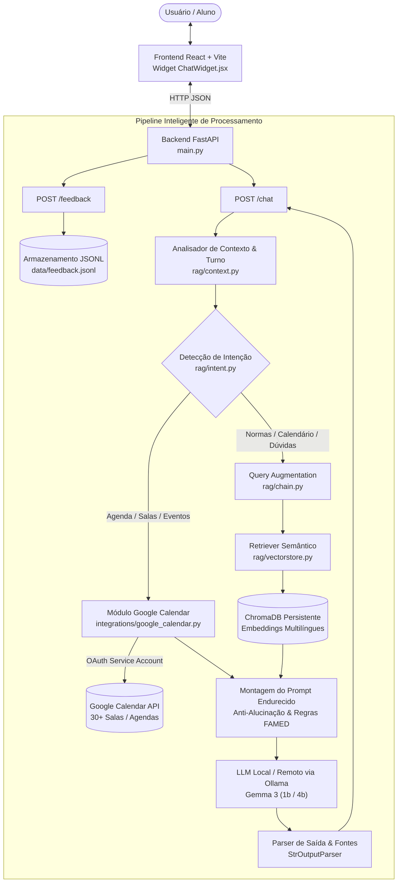

# Secretaria Virtual — Faculdade de Medicina (FAMED / UFPA)

> **Assistente Virtual Inteligente para Atendimento Acadêmico com RAG Multidomínio, Janela de Contexto Conversacional Inteligente e Integração em Tempo Real com o Google Calendar.**

---

## 📌 Sumário

- [Visão Geral](#-visão-geral)
- [Principais Funcionalidades](#-principais-funcionalidades)
- [Arquitetura da Solução](#-arquitetura-da-solução)
- [Base de Conhecimento Curada](#-base-de-conhecimento-curada)
- [Stack Tecnológica](#-stack-tecnológica)
- [Estrutura do Repositório](#-estrutura-do-repositório)
- [Guia de Instalação e Execução](#-guia-de-instalação-e-execução)
  - [1. Pré-requisitos](#1-pré-requisitos)
  - [2. Configurar o Modelo de IA (Ollama)](#2-configurar-o-modelo-de-ia-ollama)
  - [3. Configurar e Executar o Backend](#3-configurar-e-executar-o-backend)
  - [4. Configurar e Executar o Frontend](#4-configurar-e-executar-o-frontend)
  - [5. Configurar a Integração com o Google Calendar](#5-configurar-a-integração-com-o-google-calendar)
- [Variáveis de Ambiente (.env)](#-variáveis-de-ambiente-env)
- [Endpoints da API](#-endpoints-da-api)
- [Como Atualizar a Base de Conhecimento](#-como-atualizar-a-base-de-conhecimento)
- [Scripts Utilitários e Testes](#-scripts-utilitários-e-testes)
- [Privacidade e Conformidade com a LGPD](#-privacidade-e-conformidade-com-a-lgpd)
- [Créditos e Licença](#-créditos-e-licença)

---

## 📖 Visão Geral

A **Secretaria Virtual da FAMED/UFPA** é um assistente conversacional inteligente projetado para orientar discentes, docentes e técnicos da Faculdade de Medicina da Universidade Federal do Pará. O sistema resolve uma das principais dores da rotina acadêmica: o acesso rápido, confiável e descomplicado a normas regimentais, fluxos processuais, prazos de calendário, serviços no SAGITTA/SIGAA e disponibilidade de salas em tempo real.

Diferente de chatbots genéricos, a aplicação opera com uma arquitetura **RAG (Retrieval-Augmented Generation)** estritamente fundamentada, onde **toda resposta é ancorada em documentos oficiais curados e agendas institucionais**, prevenindo alucinações e garantindo respostas com respaldo normativo e citação explícita das fontes consultadas.

---

## ✨ Principais Funcionalidades

### 1. RAG Multidomínio Especializado
- Respostas precisas extraídas de **mais de 20 documentos oficiais curados**, incluindo:
  - Calendário Acadêmico 2026 oficial da UFPA (dividido por períodos: `2026.1`, `2026.2`, `2026.3` e `2026.4`).
  - PPC Medicina 2025 vs. PPC 2010 (regras de transição, blocos, internato e ementas).
  - Regulamento Geral de Graduação e Regimentos (UFPA e FAMED).
  - Resoluções de Avaliação Substitutiva / 2ª Chamada (prazos estritos de 72 horas úteis).
  - Diretrizes para Trabalho de Conclusão de Curso (TCC I e TCC II, LAEPE e normas ABNT).
  - Regras de Aproveitamento de Estudos e dispensa de disciplinas.
  - Tabela de horas para Atividades Complementares e Atividades Flexibilizadas.
  - Serviços de apoio: **SAPE** (Apoio Pedagógico), **PEAPS** (Apoio Psicossocial e Saúde Mental), **CADES/DACESS** (Acessibilidade e adaptações razoáveis para PCD, TEA e TDAH).
  - Tratamento Acadêmico Excepcional (TAE / regime domiciliar), Comitê de Ética em Pesquisa (CEP/Plataforma Brasil) e prevenção de jubilamento/prescrição de curso.

### 2. Janela de Contexto Conversacional Inteligente
- **Detecção de Continuidade (Follow-up):** Reconhece pronomes e perguntas curtas encadeadas (*"e qual o prazo dele?"*, *"dá tempo de fazer este ano?"*, *"e amanhã?"*) e utiliza o histórico recente para manter a coerência temática.
- **Isolamento de Novos Assuntos (Zero Contaminação):** Quando o usuário muda de tópico, o histórico passado é isolado para evitar que assuntos anteriores poluam a nova busca vetorial ou induzam o modelo ao erro.
- **Query Augmentation Temporal:** Identifica termos como *"atual"*, *"hoje"*, *"nesse período"* e enriquece a busca no banco vetorial automaticamente com o código do período acadêmico corrente.

### 3. Integração em Tempo Real com Google Calendar
- Conexão via **Google Calendar API (Service Account)** monitorando mais de 30 salas, laboratórios, auditórios e agendas institucionais da FAMED.
- Fuso horário oficial ajustado para **Belém/PA (UTC-3)**.
- Extração de entidades na pergunta do usuário (reconhecimento de nomes de professores, matérias, salas e datas relativas como *"hoje"* ou *"amanhã"*).
- Cache em memória com TTL de 5 minutos para performance máxima e prevenção de rate limiting da API.

### 4. Grounding Rigoroso e Prevenção de Alucinação
- Desambiguação de termos críticos (ex.: diferenciação explícita entre **Trancamento Voluntário pelo Discente** via SIGAA e **Trancamento Administrativo pelo CIAC**).
- Fallback oficial: se a informação não constar estritamente na base oficial, o assistente instrui o aluno a abrir requerimento no **SAGITTA**, fornecendo e-mail institucional (`coord-medicina@ufpa.br`), telefone `(91) 3201-7067` e localização física da secretaria.
- Respostas instantâneas por padrão (regex) para cumprimentos e agradecimentos, reduzindo tempo de resposta e consumo computacional.

### 5. Interface Web Moderna (Widget Institucional)
- Desenvolvida em **React + Vite**, com identidade visual verde institucional da FAMED/UFPA (`#005a2b`).
- **Mobile First:** Totalmente adaptada para smartphones, com viewport dinâmica (`100dvh`), suporte a telas cheias e botão de retorno para o portal.
- Renderização rica de **Markdown** com normalização de tópicos e passos em linhas separadas.
- **Sistema de Feedback Integrado:** Botões interativos de avaliação (*"Essa resposta ajudou? Sim / Não"*) com gravação em `data/feedback.jsonl` para curadoria contínua.
- Citação automática das fontes consultadas no rodapé de cada mensagem do assistente.

---

## 🏛 Arquitetura da Solução



---

## 📚 Base de Conhecimento Curada

A base de conhecimento residente em `backend/data/documentos_curados/` foi estruturada em Markdown semântico com títulos padronizados (`#`, `##`, `###`) e prefixos `[Fonte: ...]`, permitindo chunking de alta fidelidade:

| Arquivo | Domínio / Conteúdo Principal |
| :--- | :--- |
| `calendario_2026_curado.md` | Calendário Acadêmico 2026 completo (períodos 2026.1 a 2026.4, matrículas, feriados e prazos). |
| `guia_servicos_famed.md` | Manual consolidado de serviços: requisitos, documentos, prazos regulamentares e fluxos SAGITTA/SIPAC. |
| `faq_secretaria_famed.md` | Dúvidas mais frequentes extraídas da prática da secretaria com gatilhos em negrito. |
| `links.md` | Catálogo de links oficiais (SAGITTA, SIGAA, formulários, resoluções e canais). |
| `avaliacao_substitutiva.md` | 2ª chamada: justificativas legais aceitas, prazo de 72h úteis e trâmites. |
| `aproveitamento_estudos.md` | Dispensa e equivalência de componentes curriculares cursados na UFPA ou em outras IES. |
| `tcc_normas.md` & `manual_tcc_formatacao.md` | Normas de TCC I e II, composição de banca, LAEPE e formatação ABNT da UFPA. |
| `atividades_complementares.md` & `atividades_flexibilizadas.md` | Carga horária complementar, monitorias, pesquisa, extensão e tabelas PPC 2010 e PPC 2025. |
| `servico_apoio_pedagogico_sape.md` | SAPE, suporte ao aprendizado, PEAPS (saúde mental) e suporte a TEA/TDAH/PCD. |
| `ppc_medicina_2025.md` & `estrutura_curricular.md` | Matriz curricular, ementas, blocos semestrais e diretrizes de formação médica. |
| `regimento_faculdade_medicina.md` & `regimento_geral_ufpa.md` | Competências da Direção, congregação, conselhos e deveres discentes. |
| `regulamento_graduacao_ufpa.md` | Resolução do CONSEPE com normas gerais dos cursos de graduação. |
| `famed_institucional.md` | Localização (Campus Guamá / Umarizal), contatos, coordenação e horários de atendimento. |
| `tutoria.md`, `nucleo_docente_estruturante.md`, `nucleo_apoio_pedagogico.md` | Estrutura pedagógica, NDE, NAP e programa de tutoria docente-discente. |

---

## 🛠 Stack Tecnológica

### Backend
- **Linguagem:** Python 3.10+
- **Framework Web:** [FastAPI](https://fastapi.tiangolo.com/) com validação de schemas via [Pydantic v2](https://docs.pydantic.dev/)
- **Servidor ASGI:** [Uvicorn](https://www.uvicorn.org/)
- **Orquestração RAG:** [LangChain](https://www.langchain.com/) (`langchain-core`, `langchain-community`, `langchain-ollama`, `langchain-chroma`)
- **Embeddings:** `sentence-transformers/paraphrase-multilingual-MiniLM-L12-v2` via HuggingFace
- **Vector Store:** [ChromaDB](https://www.trychroma.com/) (persistência em disco)
- **Extração de Documentos:** `PyMuPDF` (fitz) e `MarkdownHeaderTextSplitter`
- **Integração Google:** `google-api-python-client` e `google-auth`

### Modelo de Linguagem (LLM)
- **Motor:** [Ollama](https://ollama.com/)
- **Modelos Homologados:** `gemma3:4b` (recomendado para maior capacidade de raciocínio) e `gemma3:1b` (opção ultraleve)

### Frontend
- **Biblioteca:** [React 18](https://react.dev/)
- **Bundler:** [Vite](https://vitejs.dev/)
- **Renderização de Markdown:** `react-markdown`
- **Estilização:** CSS3 puro e responsivo com variáveis customizadas, sem dependências de frameworks pesados

---

## 📂 Estrutura do Repositório

```text
Secretaria-Virtual-FAMED/
├── backend/
│   ├── app/
│   │   ├── main.py                      # Ponto de entrada FastAPI e middlewares CORS
│   │   ├── config.py                    # Configurações centralizadas via Pydantic Settings
│   │   ├── integrations/
│   │   │   └── google_calendar.py       # Integração Service Account com Google Calendar
│   │   ├── rag/
│   │   │   ├── chain.py                 # Montagem do pipeline RAG, prompts e data helpers
│   │   │   ├── context.py               # Gerenciador de contexto conversacional e anáforas
│   │   │   ├── intent.py                # Classificador de intenção (agenda vs. normas)
│   │   │   ├── loader.py                # Parser semântico dos markdowns curados
│   │   │   ├── embeddings.py            # Instanciação do modelo de embeddings (singleton)
│   │   │   └── vectorstore.py           # Gestão do ChromaDB e script de indexação
│   │   └── routers/
│   │       ├── chat.py                  # Endpoint POST /chat
│   │       └── feedback.py              # Endpoint POST /feedback
│   ├── data/
│   │   ├── documentos_curados/          # 21+ Markdowns com a base consolidada de conhecimento
│   │   ├── calendario_2026_curado.md    # Calendário acadêmico estruturado
│   │   ├── Calendario_Academico_*.pdf   # PDF original da UFPA
│   │   └── feedback.jsonl               # Armazenamento contínuo das avaliações dos usuários
│   ├── credentials/                     # Chaves JSON de Service Account (Google Cloud)
│   ├── chroma_db/                       # Banco vetorial persistido gerado na indexação
│   ├── requirements.txt                 # Dependências Python
│   ├── .env.example                     # Modelo das variáveis de ambiente
│   └── test_*.py                        # Scripts de teste automatizado de recuperação e RAG
│
├── frontend/
│   ├── src/
│   │   ├── assets/                      # Logotipos oficiais FAMED e ícones
│   │   ├── components/
│   │   │   ├── ChatWidget.jsx           # Botão flutuante e container principal
│   │   │   ├── ChatWidget.css
│   │   │   ├── ChatWindow.jsx           # Janela de diálogo e orquestração de mensagens
│   │   │   ├── ChatWindow.css
│   │   │   ├── MessageBubble.jsx        # Balão de mensagem, Markdown, fontes e feedback
│   │   │   ├── MessageBubble.css
│   │   │   ├── ChatInput.jsx            # Campo de entrada de texto e envio
│   │   │   └── ChatInput.css
│   │   ├── App.jsx                      # Componente raiz da aplicação
│   │   ├── App.css
│   │   ├── main.jsx                     # Bootstrap do React
│   │   └── index.css                    # Estilos globais
│   ├── index.html                       # HTML da página com meta tags
│   ├── package.json                     # Dependências do frontend
│   └── vite.config.js                   # Configurações do Vite
│
├── scripts/
│   ├── email_inventory.py               # Inventário de pastas de e-mail institucional (MBOX/IMAP)
│   ├── email_extract_anonymize.py       # Extração e anonimização LGPD de atendimentos reais
│   └── build_services_faq.py            # Geração automatizada do guia de serviços e FAQ
│
└── README.md                            # Documentação completa do projeto
```

---

## 🚀 Guia de Instalação e Execução

### 1. Pré-requisitos
- **Python:** Versão `>= 3.10`
- **Node.js:** Versão `>= 18.0.0` e `npm`
- **Ollama:** Instalado e em execução ([Download Ollama](https://ollama.com/))
- **Git**

---

### 2. Configurar o Modelo de IA (Ollama)

Certifique-se de que o Ollama está rodando e baixe o modelo desejado (o padrão configurado é o Gemma 3 4B):

```bash
# Baixar o modelo recomendado
ollama pull gemma3:4b

# (Opcional) Caso utilize hardware com menos memória, pode usar o modelo 1B:
ollama pull gemma3:1b

# Confirmar se o modelo está listado
ollama list
```

---

### 3. Configurar e Executar o Backend

#### A. Criar o ambiente virtual e instalar dependências
No terminal, navegue até a pasta `backend`:

```bash
cd backend

# Criar ambiente virtual Python
python -m venv .venv

# Ativar ambiente virtual
# No Windows (PowerShell):
.venv\Scripts\activate
# No Linux / macOS:
source .venv/bin/activate

# Instalar dependências
pip install -r requirements.txt
```

#### B. Configurar o arquivo `.env`
Copie o modelo de exemplo para criar seu arquivo de configuração local:

```bash
# No Windows (PowerShell):
Copy-Item .env.example .env
# No Linux / macOS:
cp .env.example .env
```

Edite o arquivo `.env` se desejar alterar o modelo (`gemma3:4b` ou `gemma3:1b`), a URL do Ollama ou os IDs de calendário.

#### C. Indexar a Base de Conhecimento no ChromaDB
Antes de iniciar a API pela primeira vez (ou sempre que editar os arquivos em `documentos_curados`), execute o comando de indexação:

```bash
# Com o .venv ativado dentro de backend/:
python -m app.rag.vectorstore
```

> **Tempo estimado:** 1 a 3 minutos na primeira vez (o modelo de embeddings do Hugging Face será baixado localmente). Os vetores serão persistidos na pasta `backend/chroma_db/`.

#### D. Iniciar o Servidor FastAPI
Execute o Uvicorn:

```bash
uvicorn app.main:app --reload --host 0.0.0.0 --port 8000
```

A API estará disponível em:
- **Health Check:** `http://localhost:8000/health`
- **Swagger UI interativo:** `http://localhost:8000/docs`
- **Redoc:** `http://localhost:8000/redoc`

---

### 4. Configurar e Executar o Frontend

Abra um novo terminal e navegue até a pasta `frontend`:

```bash
cd frontend

# Instalar dependências Node.js
npm install

# Iniciar o servidor de desenvolvimento
npm run dev
```

O frontend estará disponível em:
👉 **`http://localhost:5173`**

*(A interface também pode ser acessada na rede local pelo IP da sua máquina, inclusive via smartphone, graças à flag `--host` do Vite e ao CORS liberado no FastAPI).*

---

### 5. Configurar a Integração com o Google Calendar

A aplicação já possui suporte nativo para consulta de salas, horários e reuniões em tempo real.

1. No **Google Cloud Console**, crie ou selecione um projeto e ative a **Google Calendar API**.
2. Crie uma **Conta de Serviço (Service Account)** e gere uma chave em formato **JSON**.
3. Salve o arquivo JSON na pasta `backend/credentials/` (exemplo: `backend/credentials/service_account.json`).
4. Compartilhe as agendas do Google (permissão de *Ver todos os detalhes dos eventos*) com o e-mail da Conta de Serviço criada.
5. No arquivo `backend/.env`, configure o caminho do JSON e os IDs das agendas:
   ```env
   GOOGLE_CREDENTIALS_PATH=credentials/service_account.json
   GOOGLE_CALENDAR_ID=id_da_agenda_1@group.calendar.google.com,id_da_agenda_2@group.calendar.google.com
   GOOGLE_CALENDAR_DAYS_AHEAD=14
   ```

---

## ⚙ Variáveis de Ambiente (.env)

| Variável | Padrão | Descrição |
| :--- | :--- | :--- |
| `OLLAMA_MODEL` | `gemma3:4b` | Nome do modelo Ollama (`gemma3:4b`, `gemma3:1b`, etc.). |
| `OLLAMA_BASE_URL` | `http://localhost:11434` | Endpoint HTTP da instância do Ollama (ou URL túnel do ngrok). |
| `EMBEDDINGS_MODEL` | `sentence-transformers/paraphrase-multilingual-MiniLM-L12-v2` | Modelo HuggingFace para geração dos vetores textuais. |
| `CHROMA_PATH` | `chroma_db` | Diretório relativo para persistência do banco ChromaDB. |
| `CHROMA_COLLECTION` | `calendario_2026` | Nome da coleção no ChromaDB. |
| `RETRIEVER_K` | `8` | Quantidade de chunks relevantes retornados por consulta. |
| `GOOGLE_CREDENTIALS_PATH` | `credentials/...json` | Caminho relativo do arquivo de credenciais da Service Account. |
| `GOOGLE_CALENDAR_ID` | `primary` | IDs das agendas do Google Calendar separados por vírgula. |
| `GOOGLE_CALENDAR_DAYS_AHEAD` | `14` | Janela de dias à frente a monitorar na agenda. |

---

## 📡 Endpoints da API

### `POST /chat`
Processa a mensagem do usuário, aplica controle contextual, consulta o banco vetorial / agenda e retorna a resposta com fontes.

**Corpo da Requisição (JSON):**
```json
{
  "message": "Qual é o prazo para solicitar avaliação substitutiva?",
  "history": [
    { "role": "user", "content": "Perdi uma prova da faculdade." },
    { "role": "assistant", "content": "Você pode solicitar uma avaliação substitutiva..." }
  ]
}
```

**Resposta de Sucesso (200 OK):**
```json
{
  "answer": "O discente deve solicitar a avaliação substitutiva no prazo máximo de até **72 (setenta e duas) horas úteis** após a realização da avaliação regular...",
  "sources": [
    "Avaliação Substitutiva — FAMED/UFPA",
    "Guia de Serviços Acadêmicos — FAMED/UFPA"
  ]
}
```

---

### `POST /feedback`
Registra a avaliação do usuário sobre a utilidade da resposta para auditoria e aprimoramento contínuo.

**Corpo da Requisição (JSON):**
```json
{
  "helpful": true,
  "question": "Como faço trancamento de matrícula?",
  "answer": "Para fazer o trancamento total do período letivo pelo SIGAA...",
  "comment": null
}
```

**Resposta:**
```json
{
  "status": "success",
  "message": "Feedback registrado com sucesso"
}
```
*Os registros são persistidos com timestamp UTC em `backend/data/feedback.jsonl`.*

---

### `GET /health` e `GET /`
Verifica a integridade e disponibilidade do serviço FastAPI.

---

## 🔄 Como Atualizar a Base de Conhecimento

Sempre que uma nova resolução for aprovada ou o calendário acadêmico for retificado pela UFPA:

1. Adicione ou edite o documento correspondente em formato Markdown (`.md`) dentro de `backend/data/documentos_curados/` (ou edite `calendario_2026_curado.md`).
2. Mantenha os cabeçalhos semânticos (`# Título Principal`, `## Seções`, `### Subseções`) e linguagem limpa.
3. No terminal do backend (com o `.venv` ativo), rode:
   ```bash
   python -m app.rag.vectorstore
   ```
4. O script removerá o banco antigo e criará uma nova coleção vetorial indexada em segundos. Reinicie o servidor se necessário.

---

## 🧪 Scripts Utilitários e Testes

O repositório inclui suítes de testes práticos e scripts de engenharia de dados:

- **Testar recuperação de perguntas reais:**
  ```bash
  python test_curated_suite.py
  ```
- **Testar integração com Google Calendar:**
  ```bash
  python test_calendar_integration.py
  ```
- **Testar classificador de intenções:**
  ```bash
  python test_intent.py
  ```
- **Pipeline de Mineração de E-mails Institucionais (`scripts/`):**
  - `email_inventory.py`: Realiza varredura e volumetria de mensagens da caixa institucional sem expor conteúdos pessoais.
  - `email_extract_anonymize.py`: Higieniza e anonimiza e-mails de atendimento discente em estrita conformidade com a LGPD.
  - `build_services_faq.py`: Sintetiza dúvidas recorrentes reais gerando os arquivos `faq_secretaria_famed.md` e `guia_servicos_famed.md`.

---

## 🔒 Privacidade e Conformidade com a LGPD

O projeto foi concebido seguindo os preceitos da **Lei Geral de Proteção de Dados (Lei nº 13.709/2018)**:
- Não há armazenamento de dados pessoais não autorizados de estudantes (nomes completos, números de CPF, números de matrícula ou dados de saúde são estritamente anonimizados em scripts de mineração).
- O módulo de feedback registra unicamente os textos das interações e utilidade técnica da resposta para fins estatísticos e de aprimoramento da IA.
- O acesso ao Google Calendar é de leitura restrita (`calendar.readonly`) via credenciais autenticadas de Service Account, sem permissão de escrita ou exclusão.

---

## 👥 Créditos e Licença

Desenvolvido para apoio discente e modernização institucional da **Faculdade de Medicina (FAMED)** do **Instituto de Ciências Médicas (ICM)** da **Universidade Federal do Pará (UFPA)**.

Projeto acadêmico e institucional — uso interno e comunitário voltado à comunidade universitária da UFPA.
